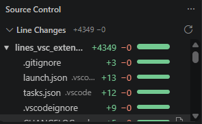

# Diffstat

See how many lines you've added and removed since your last commit, with GitHub-style green/red bars, right in the **Source Control** tab.



## Features

- **Line Changes view** inside the Source Control tab, under the built-in changes list:
  - each repository's total (`+142 −37 · 5 files`)
  - lines added (green) and removed (red) for every changed file
  - a bar per file and per repo that shows the split: 80 added and 20 removed is 80% green, 20% red
  - click a file to open its diff, just like in the built-in view
  - when the view is collapsed, its title still shows the total (`Line Changes  +142 −37`)
- **Bottom Status bar total**: `+142` in green and `−37` in red. Click it to jump to the view.
- Colors follow your theme's git colors.
- Updates automatically as you edit, stage and commit.
- Counts new (untracked) files as added lines. You can turn this off.
- Can show staged and unstaged changes in separate groups.
- Works with multiple repositories and multi-root workspaces.

```
SOURCE CONTROL
 ├─ Changes                               (built-in)
 └─ LINE CHANGES                    +142 −37
     ▾ my-repo  3 files     +142 −37  ███████▒▒▒
         app.ts     src       +80 −12  ████████▒▒
         util.ts    src       +50 −25  ██████▒▒▒▒
         README.md            +12 −0   ██████████
```

## Settings

| Setting | Default | Description |
| --- | --- | --- |
| `diffstat.statusBar.enabled` | `true` | Show the total in the status bar. |
| `diffstat.includeUntracked` | `true` | Count every line of new (untracked) files as added. |
| `diffstat.splitStagedChanges` | `false` | Show staged and unstaged changes as separate groups. Totals still compare the working tree with the last commit. |

## How lines are counted

The numbers come from `git diff HEAD --numstat`: your working tree, staged and unstaged, compared with the last commit. Things to know:

- A modified line counts as one removed line and one added line.
- Binary files are listed without line counts.
- Files ignored by `.gitignore` are not counted.
- In a repository with no commits yet, everything counts as added.

## Requirements

- VS Code 1.90 or newer, with the built-in Git extension enabled
- A trusted workspace. The extension runs git, so it stays off in Restricted Mode.

## Release Notes

See the Changelog tab.
