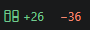

# Diffstat

See how much you've changed since your last commit. Diffstat adds a **Line Changes** view to the Source Control tab. It shows the lines added and removed in every changed file, with a green/red bar for the split.

## Features

- **Line counts per file**: `+80 −12` for every changed file, in your theme's git colors.
- **Diffstat bars**: each bar shows the share of added and removed lines. 80 added and 20 removed fills it 80% green and 20% red.
- **Totals**: for each repository, in the view header (even when the view is collapsed) and in the status bar.
- **Current file**: the counts for the file you're editing, on the right side of the status bar.
- **Click to diff**: clicking a file opens the same diff as the built-in Changes list.
- **Live updates**: the counts change as you edit, stage and commit.
- **New files**: untracked files count as added lines. You can turn this off.
- **Staged and unstaged**: optionally shown as two separate groups.
- **Multiple repositories**: works with several repositories and multi-root workspaces.

## Status bar

The status bar at the bottom of the window shows the total since your last commit, with `+142` in green and `−37` in red. It stays visible while the Source Control tab is closed.

- Hover over it to see the total for each repository.
- Click it to open the Line Changes view.
- To hide it, set `diffstat.statusBar.enabled` to `false`.

On the right side, the status bar shows the counts for the file in the active editor, like `+12 −3`. It only appears when that file has changes. It counts saved changes, so it updates when you save.

- Click it to open the file's diff.
- To hide it, set `diffstat.statusBar.currentFile` to `false`.

## Settings

| Setting | Default | Description |
| --- | --- | --- |
| `diffstat.statusBar.enabled` | `true` | Show the total in the status bar. |
| `diffstat.statusBar.currentFile` | `true` | Show the counts for the file you're editing in the status bar. |
| `diffstat.includeUntracked` | `true` | Count every line of untracked files as added. |
| `diffstat.splitStagedChanges` | `false` | Show staged and unstaged changes as separate groups. Totals still compare the working tree with the last commit. |

## How lines are counted

Diffstat compares your working tree, staged and unstaged, with the last commit, like `git diff HEAD --numstat`.

- A modified line counts as one removed and one added line, the same as in git.
- Binary files are listed without line counts.
- Files ignored by `.gitignore` are not counted.
- In a repository without commits, everything counts as added.

## Requirements

- VS Code 1.90 or newer, with the built-in Git extension enabled.
- A trusted workspace. Diffstat runs git, so it stays off in Restricted Mode.
